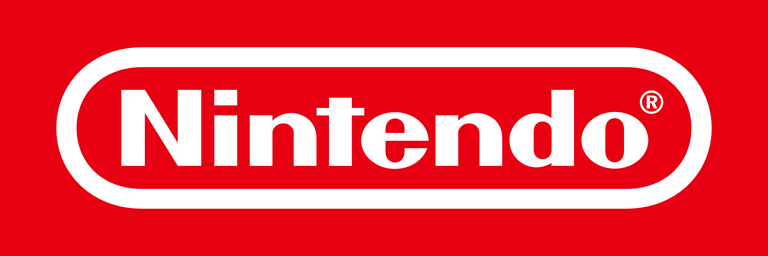

# Nintendo para Home Assistant

Seus consoles Nintendo Switch / Switch 2 no Home Assistant: tempo de jogo, jogos do dia, último jogo, "jogando agora", limites, hora de dormir, tempo extra, PIN e registro de novos consoles. Usa a mesma API do app oficial **Controle dos pais do Nintendo Switch**, com o login oficial da Nintendo (inclusive o código enviado por e-mail). Nada passa por servidores de terceiros.

## Instalação

1. HACS → repositório personalizado `hudsonbrendon/ha-nintendo` (Integração) → instalar → reiniciar.
2. **Configurações → Dispositivos e serviços → Adicionar → Nintendo**.
3. Abra o link mostrado, entre na conta Nintendo (e-mail + senha; se a Nintendo pedir, digite o código que chegou no e-mail).
4. Na tela **Vincular uma conta**, clique com o botão direito em **Usar esta conta** → *Copiar endereço do link* e cole no HA.

O login fica salvo como `session_token` (validade longa). Se a Nintendo invalidar, o HA pede para refazer o passo 3–4.

## Entidades (por console)

| Tipo | Entidades |
|---|---|
| Sensor | Tempo de jogo hoje / ontem / 7 dias / 30 dias / último mês, Último jogo (com capa), Jogos hoje, Limite hoje, Tempo restante, Hora de dormir hoje, Sincronização, Última atualização, Região |
| Binary sensor | Jogando |
| Number | Limite diário (0 = sem limite) |
| Switch | Suspender jogo no limite, Hora de dormir |
| Time | Alarme da hora de dormir (16–23h), Fim da hora de dormir (05–09h) |
| Select | Nível de restrição, Modo do limite (todos os dias / por dia da semana) |
| Text | PIN do controle parental, Nome do console |
| Button | Tempo extra +15 min / +30 min / +1 h, Tempo ilimitado hoje, Cancelar tempo extra |

Conta: sensor **Consoles** (com Mii), botão **Gerar código de registro** e sensor **Código de registro**. Para adicionar um console (ex.: Switch 2): aperte o botão, no console vá em *Configurações do sistema → Controle dos pais → Usar o smartphone* e digite o código. Quando a Nintendo confirmar, a integração recarrega sozinha com o console novo.

## Limitações (da Nintendo, não da integração)

- **Bateria, brilho, volume, jogo em tempo real**: a Nintendo não envia isso para a nuvem. "Jogando" é inferido pelo aumento do tempo de jogo (o console reporta de tempos em tempos, então liga/desliga com atraso).
- O console precisa estar registrado no Controle dos pais (botão acima). Com nível "Sem restrição" e sem limite, nada muda no uso.
- Cartões de jogo virtuais e assinatura Nintendo Switch Online só existem na API web do portal, que exige sessão de navegador — fora do escopo.

Detalhes técnicos em [REVERSE_ENGINEERING.md](REVERSE_ENGINEERING.md).
